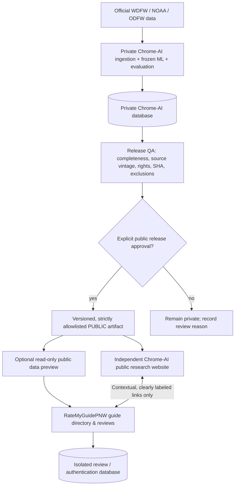

# ADR 0001 — Two independent products, interoperable by reviewed public evidence

**Decision:** ACCEPTED by the principal, November 13, 2026. **Owner:** principal. **Technical orchestrator:** ChatGPT. **Contributors:** Grok (engineering) and Gemini Pro (research/UX). This decision supersedes the prior *one consumer website for everything* recommendation.

## Product boundaries

| | RateMyGuidePNW | Chrome-AI |
|---|---|---|
| User problem | Discover and evaluate fishing guides using credible, fair angler experiences | Understand fisheries using documented government data, and, only when demonstrated, forecast quality |
| Primary site | `ratemyguidepnw.com` | Separate public research site, name/domain **not yet selected** |
| Existing code repository | PUBLIC `bezzantsam/ratemyguidepnw.com` (Next.js) | PRIVATE `bezzantsam/chrome-ai` (Python + ML), later a **separate public-only frontend repository** if justified |
| Data owned | Guide directory, authenticated reviews, claims, verified-trip evidence and moderation | Source captures, official fishery data, frozen model, forecast issuance, later independent model evaluation |
| Authentication | Guide/reviewer flows (after security review) | No shared login for public research v1; possible later dedicated access |
| Commercial product | Legitimate paid guide tools and sponsored placements, explicitly separate from ratings | Data tools or subscriptions, **only after lawful release and demonstrated value** |
| Nonnegotiable | No paid review manipulation or unverified license/USCG badges | No personal review data as ML labels; no premature 2027 accuracy claims |

**Do not merge the repos, databases, customer identity tables, DNS configurations, analytics identifiers, billing plans, or private Supabase credentials.** The currently public `/intel/buoy-10-chinook` page and `/intel/methodology` are preserved as transitional context pages; **they are not the long-term home for Chrome-AI**. Later, replace the detailed tools with source-attributed previews and links to the independent Chrome-AI website after its domain and availability are verified. Never add a broken placeholder external URL.

## Architectural shape (separate sites)

**V1 interoperability = links and vetted public data**, not shared database queries, not shared authentication, and not a new live cross-repository secret. Both sites independently respect privacy policies and source terms.

## Initial cross-product public evidence contract

Canonical candidate schema: `docs/contracts/chrome-public-observations-v1.schema.json`.

This is a specification, **not a live endpoint or already-published export**. The first qualifying payload may include only:
- `schema_version`, `release_id`, explicit review status, `released_at_utc` and source as-of timestamps
- Official **Chinook-only** Buoy 10 sample-day observations including `sampled_anglers`, `retained_chinook` and clearly named `retained_chinook_per_sampled_angler`
- Verified agency URL, WDFW data source SHA, exact date and temporal/spatial scope, disclosure of preliminary status
- An explicit interpretation/limitation statement and no future predictive performance values

It must never include: user identities, reviews, booking proofs, guide scores, private Chrome-AI connection strings, raw internal artifacts, private forecast rows, speculative fishing regulations, unverified 2027 performance, paid placement data or unapproved samples.

**Publish mechanism** to be designed: private Chrome-AI builds a public-only versioned release after source validation and review; a separate, narrowly scoped GitHub App or approved publication channel delivers that artifact to the Chrome public site. RateMyGuidePNW can consume a **read-only, cacheable public artifact** only once it is independently hosted and validated; use fallback/last-reviewed timestamp on failures. Avoid frontend requests to either private database.

## Source truth / market research caveats

Gemini's strategic memo contains useful hypotheses, but its example figures (such as full-fishery Chinook totals, cross-domain conversion losses, named competitor fee percentages, and asserted tide-bite thresholds) **are not independently verified**. They are **not production data**. Treat the suggested "verified trip" and "active license" badges as feature proposals until validation workflows exist. The audited 2026 WDFW excerpt currently approved on site is **1,373 retained Chinook / 5,087 sampled anglers across 31 preliminary August sample dates**; do not conflate sampled counts with whole-fishery totals or individual catch odds.

## Product and deployment sequencing

1. **Now:** separate branding/ownership. Freeze further Chrome-AI-specific feature additions to RateMyGuidePNW except transitional provenance, accurate links and review context. Keep existing content intact until the independent Chrome site exists.
2. **Next:** Grok audits safe Chrome-AI public frontend patterns and proposes a **separate read-only public site**. It cannot read private repo through the public site's build credentials. Its first UI is a *methodology + sourced historical dashboard*, not a forecast claim.
3. **In parallel:** Gemini validates user journeys, brand navigation, trust policy and market evidence independently for both sites.
4. **Then:** implement a versioned public release schema, executable privacy/provenance validators and a deliberately approved release promotion; no automatic unreviewed data publicity.
5. **Only when available:** choose a Chrome-AI domain, configure a **separate** Vercel/deployment project and SSL/DNS after principal approval. Create cross-links and minimal dated official-data previews without sharing personal information.
6. **Later:** a verified-trip guide trust workflow and 2027 prospective model evaluation move on their **own** timelines. No model skill or premium forecasts until objectively validated.

## Three-AI work protocol

| Role | Responsibility | Handoff evidence |
|---|---|---|
| **Principal** | Brand decisions, product priorities, domains, budget, trust policy and production release | Explicit go/no-go |
| **ChatGPT (orchestrator)** | Maintain ADR, contracts, GitHub issue dependencies, review PRs, CI and deployment checks; resolve conflicts; enforce privacy/data releases | Approved PR & recorded test results |
| **Grok (engineer)** | Narrow branch-scoped code, source schema validators, test suites, UI prototype for separate Chrome site | Draft PR or complete patch against exact base SHA, plus tests |
| **Gemini (research/UX)** | Evidence-backed competitor research, one-site-vs-two implications **with two-site decision fixed**, information architecture, user tests/flows and trust policy | Cited concise memo; no invented data or claimed code |

Tasks do not run merely because an issue was opened. Each external agent must receive its ticket via its own interface and submit evidence. **Do not merge code automatically or claim the agents have started without their actual output.**

## Promotion gates

- source/provenance/rate calculation verified; real samples distinguished from closures and missing data
- no private/internal database credentials or source blobs in public bundles
- executable contract tests, TypeScript or Python checks as appropriate
- clear agency as-of date, provisional designation and uncertainty
- no paid influence on guide rankings or review moderation
- explicit principal approval for a new domain, authentication integration, billing or public model skill claims
